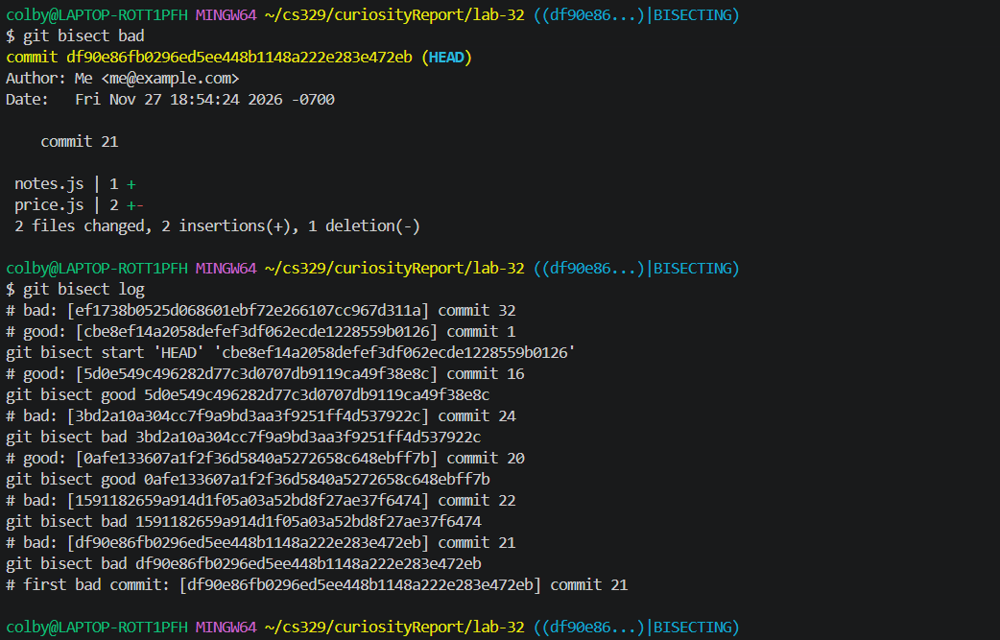
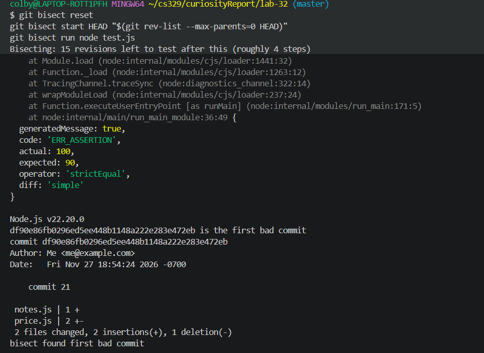
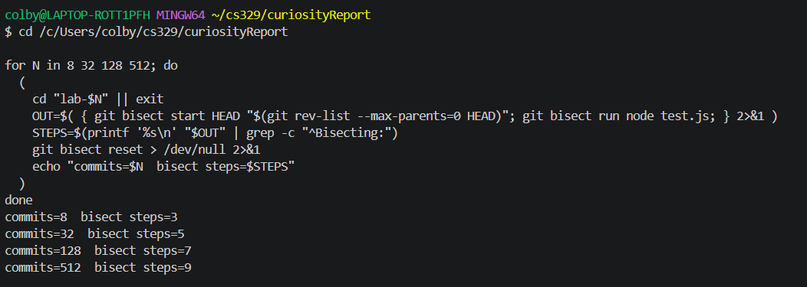
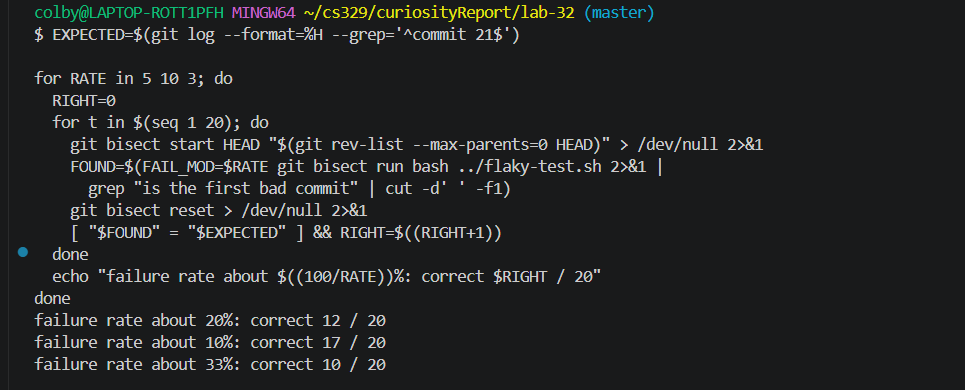

# Curiosity Report: Hunting Regressions with `git bisect`

## Why I Was Curious

I googled different strategies used in quality assurance and DevOps and found `git bisect`, which I did not know about. I wanted to understand how engineers find the change that introduced a bug when it is noticed well after it was committed. In this course we use GitHub Actions to run tests on every push; `git bisect` can use those same tests to search through commit history.

## What Is `git bisect`?

`git bisect` is a built-in Git command that searches commit history by binary search. You identify one commit where the code worked (good) and one where it is broken (bad). Git checks out a commit between them; you test it and mark it good or bad. Each answer narrows the search until Git identifies the first bad commit.

| Commits in range | Approximate steps (`log₂(N)`) |
|---:|---:|
| 8 | 3 |
| 32 | 5 |
| 1,000 | 10 |
| 1,000,000 | 20 |

`git bisect run <command>` automates the checks. Git treats exit code `0` as good and a nonzero test result as bad. That lets commands such as `npm test` drive the search.

| Term | Meaning |
|---|---|
| Good / bad commit | A commit where the bug is absent / present |
| First bad commit | The commit where the bug first appears |
| Regression | Something that used to work and now does not |
| Flaky test | A test that sometimes fails for reasons unrelated to the code |

## What I Did to Research the Topic

- Read the official [`git bisect` documentation](https://git-scm.com/docs/git-bisect).
- Read Pro Git's [Debugging with Git](https://git-scm.com/book/en/v2/Git-Tools-Debugging-with-Git) section.
- Read the Linux kernel guide to [bisecting a bug](https://docs.kernel.org/admin-guide/bug-bisect.html).
- Built a throwaway test repository and ran the experiments below.
- Checked the tool versions: Git **2.46.0.windows.1** and Node.js **v22.20.0**.

## Current State of the Art

- `git bisect` is built into Git. Related tools such as Mozilla's `mozregression` use bisection to find regressions across browser builds.
- `git bisect run` can let a script or test command judge each commit automatically.
- Merge-heavy history can make a search less straightforward because Git history is a graph. Git provides `--first-parent` to focus on the main line of merges.
- Small commits and reliable tests make the result more useful. A large squashed commit can limit the result to that entire change.
- A flaky test can mislead the search because Git relies on each test result being correct.
- Git also supports custom terms such as `old` and `new` when searching for a change in behavior.

## Experiments

The experiments used throwaway repositories created with [`make-repo.sh`](./curiosityReport/make-repo.sh). They used Git, Node.js, and Bash.

### Setup: Confirm the Test Detects the Bug

I created a 32-commit repository with the regression introduced in commit 21. The test failed at the latest commit with `100 !== 90` and printed `ok` at commit 1. This confirmed that the test could distinguish the bad and good ends of the history.

### Experiment 1: Manual Bisect

I started a bisect with the latest commit marked bad and the first commit marked good, then ran `node test.js` and marked each checked-out commit. Git identified commit 21 as the first bad commit. I tested five commits during the search: 16, 24, 20, 22, and 21.

### Experiment 2: Automated Bisect

I ran `git bisect run node test.js`. Git used the test's exit status to label commits and identified commit 21 as the first bad commit, matching the manual result. Node returned a nonzero exit status when the assertion failed.

### Experiment 3: Does It Scale Like `log₂(N)`?

I measured the number of `Bisecting:` lines printed for histories of different sizes. The count is based on the experiment script's output matching that line prefix.

| Commits | Steps measured | `log₂(N)` |
|---:|---:|---:|
| 8 | 3 | 3 |
| 32 | 4 | 5 |
| 128 | 7 | 7 |
| 512 | 9 | 9 |

The measurements are close to the logarithmic estimates, though the 32-commit count differs by one. A history of 100,000 commits would take about 17 binary-search steps, since `log₂(100,000)` is about 16.6.

### Experiment 4: What Does a Flaky Test Do to Bisect?

I ran bisect repeatedly with a test script that randomly fails on otherwise good commits. I tested failure probabilities of about 20%, 10%, and 33%, running each setting 20 times.

- Correct results at about 20% failure: **12 / 20**
- Correct results at about 10% failure: **17 / 20**
- Correct results at about 33% failure: **10 / 20**

A false result can send Git into the wrong part of the history. Repeating a test and deciding based on consistent results may make the search more reliable.

### Experiment 5 (Optional): Try It on JWT Pizza

This optional experiment can be done in a throwaway branch of `jwt-pizza-service` or another project with tests. Introduce a deliberate regression, add commits after it, then use `git bisect run` with a stable test. Record whether setup or dependency changes caused problems.

## What I Learned

1. Binary search narrowed the 32-commit history to the regression in commit 21 after testing five commits.
2. A test's exit status is enough for `git bisect run` to automate the search.
3. The measurements showed that bisect takes far fewer checks than walking through every commit as histories grow.
4. Flaky tests can give bisect an incorrect answer; the accuracy results above show how often that happened in my trials.
5. Small commits and reliable tests make it easier to connect a bisect result to the change that caused the problem.

**Challenges:** One challenge was keeping track of which commits to mark good or bad based on the test result. The bisect output took some practice to interpret, and it was easy to forget to run `git bisect reset` after finishing a search.

**Connection to the course:** CI runs tests on pushes, and our course covers Git history. `git bisect` connects those ideas: when a regression is noticed late, the same tests used in CI can help find the commit responsible. It also shows why frequent, small commits help with debugging.

## Images

The report uses four screenshots: manual bisect, automated bisect, scaling results, and flaky-test results. Save them in `curiosityReport/images/` using the filenames shown in the image links above.

## References

- [`git bisect` documentation](https://git-scm.com/docs/git-bisect)
- [Pro Git, Debugging with Git](https://git-scm.com/book/en/v2/Git-Tools-Debugging-with-Git)
- [Linux kernel documentation, bisecting a bug](https://docs.kernel.org/admin-guide/bug-bisect.html)
- [Node.js `assert` module](https://nodejs.org/api/assert.html)
